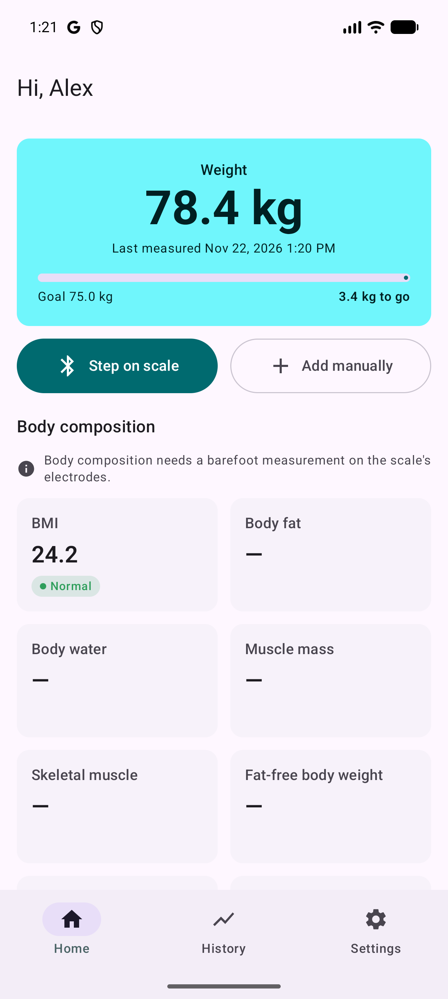
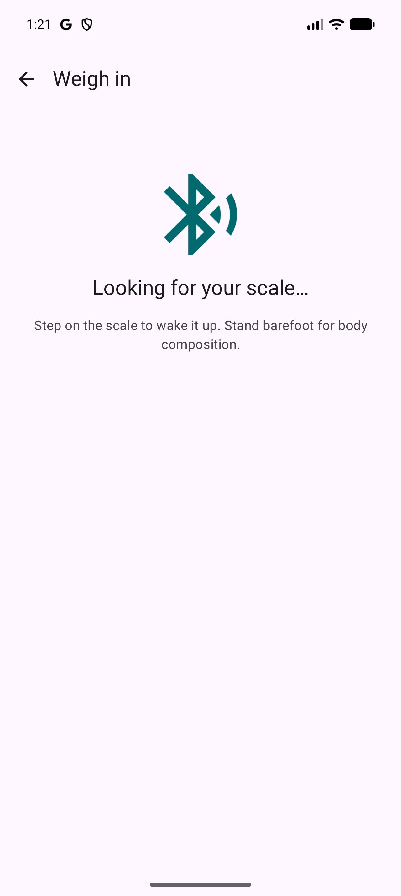
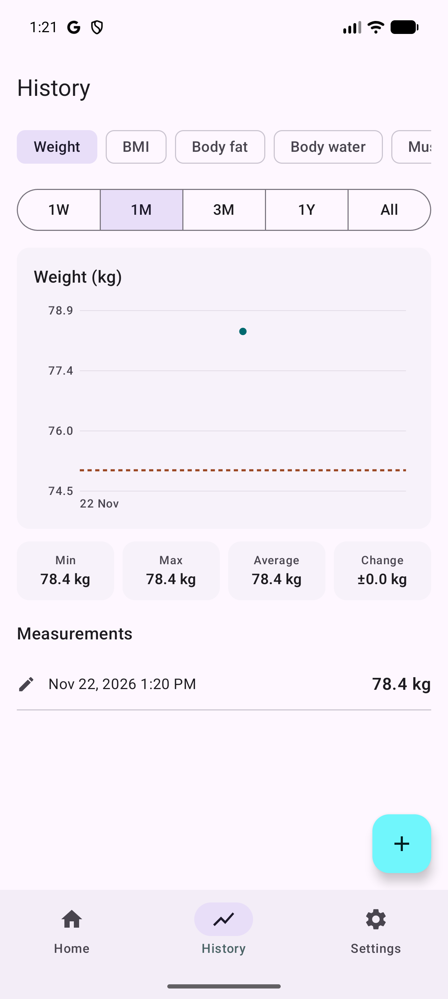
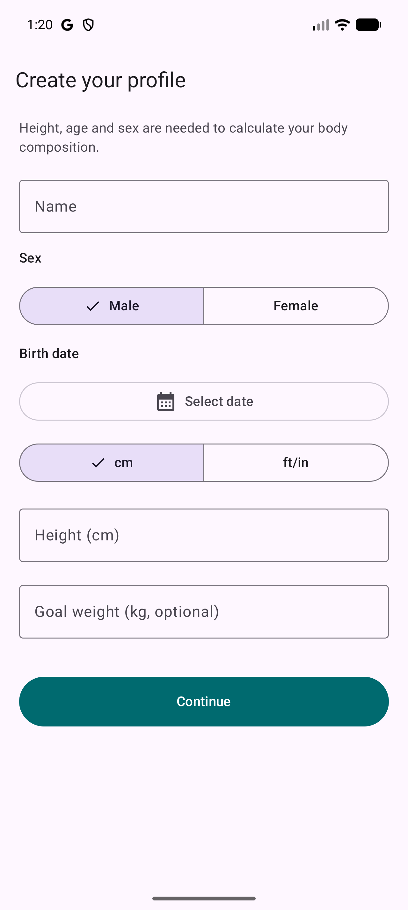
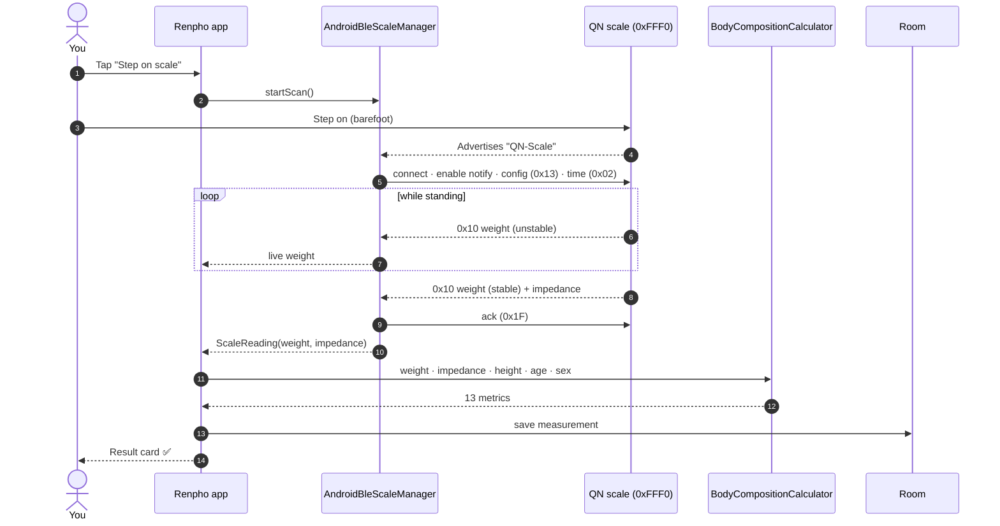
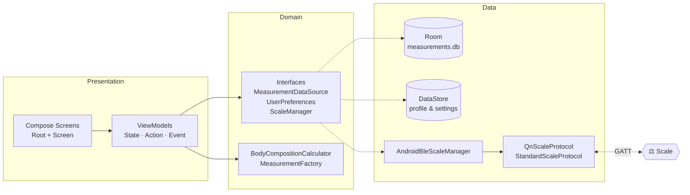

<div align="center">

# ⚖️ Renpho

### Your smart scale, your data — a modern, local-first body composition tracker

*A from-scratch Jetpack Compose companion app for Renpho / Qingniu Bluetooth body-composition scales.*

<br/>


<br/>

<table>
  <tr>
    <td align="center"><br/><sub><b>Dashboard</b></sub></td>
    <td align="center"><br/><sub><b>Weigh-in</b></sub></td>
    <td align="center"><br/><sub><b>History</b></sub></td>
    <td align="center"><br/><sub><b>Onboarding</b></sub></td>
  </tr>
</table>

</div>

---

## ✨ Highlights

<table>
<tr>
<td width="50%" valign="top">

### 📡 Talks directly to your scale
Native Bluetooth LE implementation of the **Qingniu / Yolanda** protocol used by most Renpho scales (`QN-Scale`, `Yolanda-CS20*`, …) plus the standard **Weight Scale (0x181D)** and **Body Composition (0x181B)** services. Live weight while you stand on it, automatic pairing, auto-reconnect.

</td>
<td width="50%" valign="top">

### 🧬 13 body metrics
Weight · BMI · Body fat · Visceral fat · Subcutaneous fat · Body water · Muscle mass · Skeletal muscle · Fat-free weight · Bone mass · Protein · BMR · Metabolic age — each with a colour-coded health rating.

</td>
</tr>
<tr>
<td width="50%" valign="top">

### 📈 Trends that matter
Interactive trend chart per metric with **1W / 1M / 3M / 1Y / All** ranges, goal line, min / max / average / change at a glance.

</td>
<td width="50%" valign="top">

### 🔒 Private by design
No account, no cloud, no tracking. Everything lives on your phone (Room + DataStore). Export to **CSV** whenever you want.

</td>
</tr>
<tr>
<td width="50%" valign="top">

### 🎯 Goals & units
Goal weight with progress bar, **kg / lb / st** and **cm / ft-in**, manual entries with date & time picker.

</td>
<td width="50%" valign="top">

### 🔁 History that stays consistent
Raw weight + impedance are kept for every weigh-in, so all history is **recalculated automatically** when the formulas improve.

</td>
</tr>
</table>

---

## 🧭 How it works



---

## 🏗️ Architecture

Single-module app with clean layering by package, following **MVI** (State · Action · Event) with a `Root` / `Screen` composable split.



<details>
<summary><b>📁 Project structure</b></summary>

```
app/src/main/java/com/omnitracker/renpho/
├── RenphoApplication.kt            # Koin start-up
├── MainActivity.kt / MainViewModel.kt
├── core/presentation/              # Metric definitions, unit formatting, ObserveAsEvents
├── domain/
│   ├── model/                      # UserProfile, Measurement, BodyComposition, …
│   ├── scale/ScaleManager.kt       # BLE contract (status, readings, scan, connect)
│   ├── BodyCompositionCalculator.kt
│   └── MeasurementFactory.kt
├── data/
│   ├── ble/                        # Android GATT layer + pure protocol state machines
│   └── local/                      # Room DB, DataStore prefs, recalculator
├── di/AppModules.kt                # Koin modules
├── navigation/                     # Type-safe routes + NavHost with bottom bar
├── feature/
│   ├── profile/   dashboard/   measure/
│   ├── history/   addentry/    settings/
└── ui/                             # Theme, MetricTile, StatusBadge, TrendChart (Canvas)
```

</details>

### Tech stack

| Layer | Technology |
|---|---|
| UI | Jetpack Compose · Material 3 · custom Canvas trend chart |
| Navigation | Navigation Compose 2.10 (type-safe `@Serializable` routes) |
| State | ViewModel · `StateFlow` · `Channel` events (MVI) |
| DI | Koin 4.2 |
| Persistence | Room 2.8 (KSP) · DataStore Preferences |
| Bluetooth | Android BLE GATT · coroutine-serialised operation queue |
| Build | AGP 9.6 · Kotlin 2.4.20 · Gradle version catalog · core library desugaring |
| Tests | JUnit 4 — protocol parsers, calculator, fat distribution (27 tests) |

---

## 🧪 Body composition model

The original Renpho app computes metrics in a closed native library. This app uses **published equations, calibrated against values shown by the Renpho app**:

| Metric | Method |
|---|---|
| Fat-free mass | Sun et al. 2003 (*Am J Clin Nutr*) × foot-to-foot calibration |
| Body fat | weight − fat-free mass |
| Body water · Bone | fixed fractions of fat-free mass |
| Muscle mass | fat-free mass − bone |
| Skeletal muscle | Janssen et al. 2000 (*J Appl Physiol*) × calibration |
| Protein | (fat-free mass − water − bone) / weight |
| BMR | Katch–McArdle |
| Visceral / subcutaneous fat | fat mass split by age- and sex-dependent visceral share |
| Metabolic age | age where population BMR (Mifflin–St Jeor) equals yours *(not yet calibrated)* |

> [!NOTE]
> Values are **estimates** for tracking trends — not a medical diagnosis. Body composition needs a **barefoot** measurement; with socks or manual entries only weight and BMI are recorded.

---

## 🔌 Supported scales

| Protocol | Service | Advertised names | Status |
|---|---|---|---|
| Qingniu / Yolanda (type 2) | `0xFFF0` | `QN-Scale`, `QN-Scale1` | ✅ verified on real hardware |
| Qingniu / Yolanda (type 1) | `0xFFE0` | `QN-*`, `Yolanda-CS20*`, `Renpho-*` | 🟡 implemented, untested |
| Bluetooth SIG Weight / Body Composition | `0x181D` / `0x181B` | any | 🟡 implemented, untested |

<details>
<summary><b>🔍 QN protocol cheat-sheet</b></summary>

| Direction | Opcode | Meaning |
|---|---|---|
| scale → app | `0x12` | scale info — byte 10 bit 0 = 0.01 kg resolution |
| scale → app | `0x14` | time-sync request |
| scale → app | `0x10` | weight: `[3..4]` weight BE, `[5]` 0 = live / 1 = stable, `[6..7]` impedance BE |
| app → scale | `0x13` | config (unit kg/lb) |
| app → scale | `0x02` / `0x20` | time (seconds since 2000-01-01) |
| app → scale | `0x1F` | measurement acknowledged |

Every outgoing packet ends with an 8-bit additive checksum.

</details>

---

## 🚀 Getting started

**Requirements:** Android Studio (latest canary/beta for AGP 9.6) · JDK 17+ · a phone with Bluetooth LE (Android 7.0+)

```bash
# build
./gradlew assembleDebug

# run unit tests
./gradlew testDebugUnitTest

# install on a connected phone
./gradlew installDebug
```

Then:

1. **Create your profile** — sex, birth date and height are required for body composition.
2. Tap **Step on scale**, allow *Nearby devices*, and step on barefoot.
3. The scale is paired automatically — next time it connects on its own.

---

## 🗺️ Roadmap

- [ ] Calibrate body fat sensitivity with paired weigh-ins (same step-on in both apps)
- [ ] Metabolic age model matching the vendor app
- [ ] Multiple users / family profiles
- [ ] Health Connect sync
- [ ] Home-screen widget with latest weight
- [ ] Localisation (German first)

---

## ⚠️ Disclaimer

This is an **unofficial**, independent project. It is not affiliated with, endorsed by or connected to Renpho or Qingniu. "Renpho" is a trademark of its respective owner and is used here only to describe compatibility; rename the app before distributing it. No vendor code or assets are included — the Bluetooth protocol support exists for interoperability with hardware you own.

<div align="center">
<br/>
<sub>Built with Kotlin, Compose and a bathroom scale. ⚖️💚</sub>
</div>
